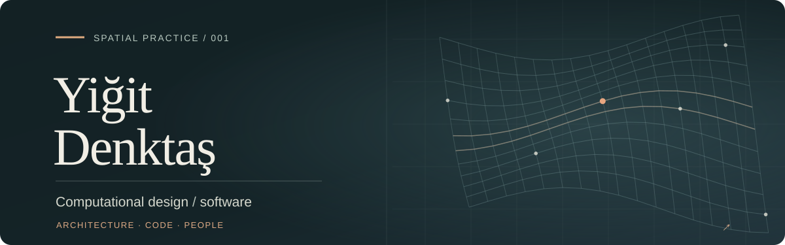

  <a href="https://zettlerei.com"><strong>Independent practice ↗</strong></a>
  &nbsp; · &nbsp;
  <a href="https://github.com/yigit-denktas/craftbot-for-reuse">Research code ↗</a>
  &nbsp; · &nbsp;
  <a href="mailto:ideas@zettlerei.com">Get in touch ↗</a>

### I make ideas work across space, software, and people.

I trained as an architect, moved into computational design, and now develop software for the built environment. My work spans **BIM, geospatial data, procedural geometry, and interactive planning tools**.

Independently, I explore how computational systems can help people **design, understand, make, and inhabit** the physical world. I'm interested in AI as a collaborator, not a substitute for human judgment.

### Selected work

**01 / [CraftBot](https://github.com/yigit-denktas/craftbot-for-reuse) · Architecture through executable code**  
A research experiment in agents that turn architectural briefs and references into Blender Python, then inspect and revise the resulting geometry. [Explore the experiments ↗](https://github.com/yigit-denktas/craftbot-for-reuse)

**02 / ARKHE · Spatial systems you can assemble**  
A modular-structure study connecting component geometry, connection graphs, fabrication, and assembly constraints. [See the study at Zettlerei ↗](https://zettlerei.com/)

**03 / [Kushluk](https://zettlerei.com/work/kushluk) · A personal paper for the morning**  
An experimental, print-first publishing tool that treats attention as something worth designing for. The public edition is an illustrative prototype, not a live news service.

**04 / [Wearhouse](https://zettlerei.com/work/wearhouse) · An evidence-first wardrobe**  
An interactive product study exploring records, provenance, and human review instead of letting AI guesses become facts.

### Questions I keep returning to

- **Spatial intelligence.** Can language models, knowledge graphs, and geometric tools reason together without losing track of physical constraints?
- **Human–computer interaction.** How can interfaces preserve agency, authorship, and human presence rather than hide decisions behind automation?
- **Design that survives contact with reality.** Can the same model connect a concept to its materials, manufacturing, assembly, and use?

### Tools & materials

`Python` · `C# / .NET` · `TypeScript / React` · `PostgreSQL / PostGIS` · `Rhino / Grasshopper` · `Three.js` · `Blender` · `Azure`

---

Some repositories are finished tools; others are bounded experiments. When a question has been answered, a project doesn't always need to become a product.

Based in Cologne · [Zettlerei](https://zettlerei.com) · [GitHub](https://github.com/yigit-denktas)
